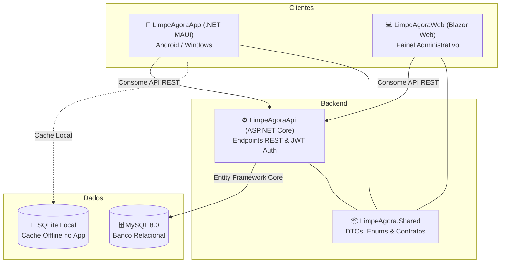

# LimpeAgora — Sistema de Gestão e Venda de Produtos de Limpeza

O **LimpeAgora** é uma solução completa para e-commerce e gestão operacional de produtos de limpeza e saneantes. O ecossistema é composto por uma **API RESTful**, um **aplicativo multiplataforma (.NET MAUI)** para clientes finais e um **portal web administrativo (Blazor)** para gestão de catálogo, pedidos e estoques.

---

## Arquitetura da Solução

O repositório é estruturado em múltiplos projetos que compartilham modelos e contratos:

```
LimpeAgora/
├── LimpeAgora.Shared/            # Modelos de domínio, DTOs compartilhados e Enums
├── LimpeAgoraApi/               # Backend Web API (ASP.NET Core, EF Core, MySQL, JWT)
├── LimpeAgoraApp/               # Aplicativo cliente mobile/desktop (.NET MAUI)
├── LimpeAgoraWeb/               # Painel web administrativo (Blazor Web App)
└── tests/
    ├── LimpeAgora.UnitTests/         # Testes unitários (API, App, Blazor Web)
    └── LimpeAgora.IntegrationTests/  # Testes de integração (API + Banco de dados)
```

### Diagrama de Comunicação



---

## Projetos e Tecnologias

### 1. LimpeAgoraApi (Backend)
- **Framework:** ASP.NET Core (.NET 10)
- **Persistência:** Entity Framework Core 9 com provedor Pomelo MySQL
- **Autenticação:** JSON Web Token (JWT) com autorização baseada em perfis (`Role-based`)
- **Criptografia:** `BCrypt.Net-Next` para hash seguro de senhas
- **Documentação:** OpenAPI / Swagger (`/openapi/v1.json`)
- **Segurança de Credenciais:** Suporte nativo a `.NET User Secrets` em ambiente de desenvolvimento

### 2. LimpeAgoraApp (Aplicativo Mobile & Desktop)
- **Framework:** .NET MAUI (.NET 10) para Android e Windows
- **Padrão:** MVVM (Model-View-ViewModel) com injeção de dependências nativa
- **Identidade Visual:** Design moderno com paleta de cores inspirada no mascote oficial do LimpeAgora e referências a padrões de UI do iFood e Duolingo
- **Armazenamento Seguro:** `SecureStorage` para armazenamento de tokens JWT e credenciais de sessão
- **Cache Offline:** Banco local SQLite (`sqlite-net-pcl`) para listagem rápida e suporte a perda temporária de conexão
- **Simulação de Dispositivo:** No Windows, a janela inicializa com aspecto responsivo de smartphone (420 × 840 px) para paridade com o ambiente mobile

### 3. LimpeAgoraWeb (Portal Administrativo)
- **Framework:** Blazor Web App (.NET 10)
- **Público:** Administradores e operadores
- **Funcionalidades:** 
  - Gestão de catálogo (Cadastro e edição de produtos e categorias)
  - Controle de estoque e preços
  - Acompanhamento em tempo real de pedidos e histórico de mudanças de status
  - Gestão de usuários e permissões de acesso

### 4. LimpeAgora.Shared (Biblioteca Compartilhada)
- DTOs para requisições e respostas da API (`Auth`, `Categorias`, `Produtos`, `Pedidos`, `Usuarios`)
- Enums centrais do negócio:
  - `PerfilUsuario`: `Cliente`, `Funcionario`, `Administrador`
  - `StatusPedido`: `Pendente`, `EmPreparacao`, `ProntoParaRetirada`, `Concluido`, `Cancelado`
  - `MetodoPagamento`: `CartaoCredito`, `CartaoDebito`, `Pix`, `Dinheiro`

---

## Funcionalidades Principais

### Fluxo do Cliente (App)
1. **Cadastro e Autenticação:** Criação de conta com validação de dados e login com retenção segura de sessão.
2. **Exploração do Catálogo:** Visualização de categorias com contadores de produtos e listagem moderna em cards.
3. **Carrinho de Compras:** Adição de produtos, ajuste interativo de quantidades, cálculo automático do subtotal e persistência temporária.
4. **Finalização do Pedido:** Revisão completa dos itens, observações opcionais e escolha do método de pagamento.
5. **Acompanhamento de Pedidos:** Tela "Meus Pedidos" com tags coloridas por status (amarelo para pendente, ciano para preparação, azul para retirada, verde para concluído e vermelho para cancelado).

### Fluxo Administrativo (Web)
1. **Painel de Controle:** Visão geral do fluxo operacional de pedidos.
2. **Gestão de Produtos e Categorias:** Criação, edição, ativação/desativação e atualização de estoque.
3. **Controle de Status de Pedidos:** Atualização do ciclo de vida dos pedidos com registro de histórico e auditoria de quem realizou a alteração.

---

## Testes Automatizados

A solução conta com **37 testes automatizados** cobrindo todas as camadas do sistema:

| Projeto | Tipo | Descrição | Quantidade |
| :--- | :--- | :--- | :---: |
| `LimpeAgora.UnitTests` | **Unitário** | Testes de regras de negócio da API, lógica do carrinho no App e renderização de componentes Blazor com bUnit e Moq | **30** |
| `LimpeAgora.IntegrationTests` | **Integração** | Testes de ponta a ponta da API via `WebApplicationFactory` com Testcontainers (MySQL) e banco em memória | **7** |
| **Total** | | | **37** |

Para executar todos os testes da solução:
```bash
dotnet test LimpeAgora.sln
```

---

## Como Executar o Projeto

### Pré-requisitos
- [.NET 10 SDK](https://dotnet.microsoft.com/download/dotnet/10.0) instalado
- Servidor MySQL 8.0 em execução (ou container Docker equivalente)
- Carga de trabalho .NET MAUI (para compilar e executar o App):
  ```bash
  dotnet workload install maui
  ```

---

### Passo 1: Configurar as Credenciais da API (User Secrets)

Para manter a segurança das senhas fora do versionamento Git, a API utiliza o **.NET User Secrets**.

No diretório raiz da solução, configure a connection string do seu MySQL local:

```powershell
dotnet user-secrets set "ConnectionStrings:DefaultConnection" "Server=localhost;Port=3306;Database=limpeagora_dev;Uid=root;Pwd=SUA_SENHA_AQUI;" --project LimpeAgoraApi/LimpeAgoraApi.csproj
```

*(Opcional)* Caso queira definir uma chave JWT personalizada para desenvolvimento:
```powershell
dotnet user-secrets set "Jwt:Key" "SuaChaveSecretaDeDesenvolvimentoComNoMinimo32Caracteres!" --project LimpeAgoraApi/LimpeAgoraApi.csproj
```

---

### Passo 2: Executar a API

```powershell
dotnet run --project LimpeAgoraApi/LimpeAgoraApi.csproj
```

- A API aplicará as migrations e o seeder automaticamente na primeira inicialização.
- Endereço padrão da API: **`http://localhost:5025`**
- Documentação Swagger/OpenAPI: **`http://localhost:5025/openapi/v1.json`**

#### Credenciais Iniciais de Administrador (Seeder de Desenvolvimento)
- **E-mail:** `admin@limpeagora.com`
- **Senha:** `Admin@123`

---

### Passo 3: Executar o Portal Web (Blazor)

Em outro terminal:

```powershell
dotnet run --project LimpeAgoraWeb/LimpeAgoraWeb.csproj
```

- Endereço padrão do Web: **`http://localhost:5059`**
- Acesse com as credenciais do administrador ou de usuários cadastrados.

---

### Passo 4: Executar o Aplicativo (.NET MAUI)

Em outro terminal:

**No Windows (Desktop):**
```powershell
dotnet run -f net10.0-windows10.0.19041.0 --project LimpeAgoraApp/LimpeAgoraApp.csproj
```

**No Android (Emulador ou Dispositivo):**
```powershell
dotnet build -t:Run -f net10.0-android --project LimpeAgoraApp/LimpeAgoraApp.csproj
```

> **Nota para Android:** No emulador do Android, o serviço `ApiClientService` resolve automaticamente o endereço do host local como `http://10.0.2.2:5025/`. No Windows desktop, utiliza `http://localhost:5025/`.

---

## Segurança e Boas Práticas

- **Zero Hardcoded Secrets:** Nenhuma senha de banco de dados ou chave criptográfica privada está versionada no Git.
- **Gitignore Fortificado:** Proteção configurada para ignorar arquivos locais SQLite (`*.db`), arquivos `.env`, configurações locais (`appsettings*.local.json`) e dumps de depuração.
- **Isolamento de Contratos:** Todas as transferências de dados entre clientes e backend são tipadas e protegidas via DTOs na biblioteca `LimpeAgora.Shared`.
- **Integridade Referencial:** Exclusões lógicas e restrições de chave estrangeira com auditoria de status em pedidos.
